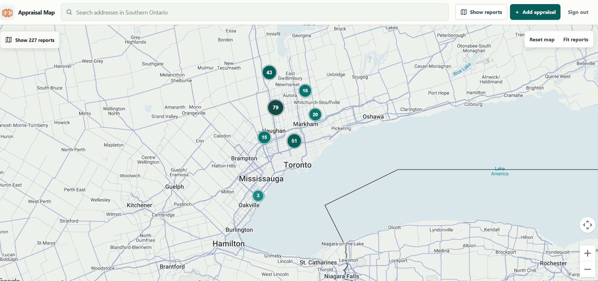
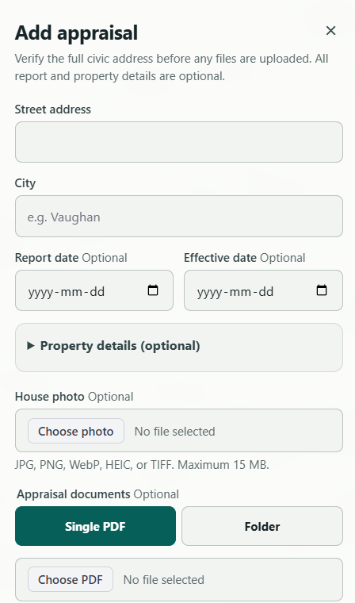

# Appraisal Map

Appraisal Map is an authenticated workspace for appraisal teams to find and review previously recorded property reports. It brings a map, report details, factual comparisons, and source documents into one workflow.

Nearby reports are research candidates. Appraisal Map does not select comparables, calculate property values, or replace an appraiser’s professional judgment.

## Screenshots

### Map workspace

Map data ©2026 Google.

### Add appraisal

## Capabilities

- Explore reports in the current map area with marker clustering and distance, property type, date, living-area, frontage, and garage filters.
- See each report's primary facts (effective or report date, living area, garage capacity, lot frontage, property type, year built) directly on cards, in details, and in the report list; absent facts read "Not recorded".
- Search for an address, confirm its location, and review nearby records; search every saved report by address, city, or property type from the report list.
- Compare up to three records using available facts such as distance, dates, property type, living area, year built, garage capacity, and lot frontage.
- Add and update records, and archive them with a reversible workflow when authorized.
- Attach photos, PDFs, or related document sets; larger uploads can resume after interruption.

## How it works

The React client uses Google Maps Platform for the map, Places address search, and geocoding. Supabase provides authentication and appraisal records. The Cloudflare Worker protects report requests and serves attachments from private R2 storage. New attachments go directly to R2. Map queries are bounded to the viewed area and paginated. Comparison distance is straight-line distance; it is not a travel distance or a valuation adjustment.

The application is configured for a Southern Ontario service area. Records and uploaded source documents are supplied by the appraisal team; this repository does not include a public listing feed or a sample property dataset. Available property facts and dates depend on what staff recorded in the source reports.

## Security and privacy

- The frontend uses a Supabase URL and anon key. These are client configuration values, not administrative secrets; database access must remain protected by Row Level Security.
- Never put a Supabase `service_role` key or other server secret in a `REACT_APP_*` variable or browser bundle.
- App roles are read from server-controlled `app_metadata`; unrecognized roles default to read-only in the client. Database policies remain the security boundary.
- Storage bucket privacy and object policies are configured separately from database row policies. Verify the deployed photo, PDF, and appraisal-document buckets are private and have the intended read, upload, and delete rules.
- Restrict the Google Maps browser key by allowed referrers and enabled APIs in Google Cloud Console. Do not commit `.env` or production credentials.
- Do not put real appraisal records, addresses, or source documents in screenshots, issue reports, or public examples.

## Local development

Requirements: Node.js and npm.

1. Install dependencies with `npm ci`.
2. Copy `.env.example` to `.env` and configure `REACT_APP_SUPABASE_URL`, `REACT_APP_SUPABASE_ANON_KEY`, and `REACT_APP_GOOGLE_MAPS_API_KEY` for a non-production environment.
3. Start the development server with `npm start`.

The app runs at `http://localhost:3000`. Use test accounts and non-production data during development.

## Checks

- `npm run lint` — ESLint checks for `src`.
- `npm run test:ci` — runs the Jest suite once.
- `npm run build` — creates the production bundle.
- `npm run verify:build` — checks the generated build output.
- `npm audit --audit-level=high` — checks installed dependencies for high or critical advisories.

## Production deployment

The production app is at https://appraisal-map.appraisal-map.workers.dev/.
The former Vercel address redirects to this app. Vercel is not the deployment
target for the Worker or its API.

Merge changes only after the quality workflow passes. Build the tested commit
with the browser configuration and `REACT_APP_STORAGE_PROVIDER=r2`, then run
`npx wrangler deploy` from the repository with the intended Cloudflare account.
Keep the existing Worker secrets in Cloudflare; never place them in the build.
After deployment, check staff sign-in, report reads, protected attachments,
and address search. See [the private storage operating guide](worker/README.md)
for required limits, backup evidence, and Worker configuration.

Independent backups must remain current. The migration recovery copy and its
scheduled backup configuration are private and are not included in this repository.

Database pings have bounded request retries, a recovery runner after failure, and
a separate schedule watchdog. See [database health operations](docs/database-health.md)
for verification, the independent Worker schedule, and provider restriction recovery.

## License and data rights

Copyright © 2026 Teamhousing123. All rights reserved. This repository is proprietary; public visibility does not grant permission to use, copy, modify, or distribute its code without separate written permission. Google Maps Platform, Supabase, and any source appraisal documents or data are subject to their respective owners’ terms and rights.
