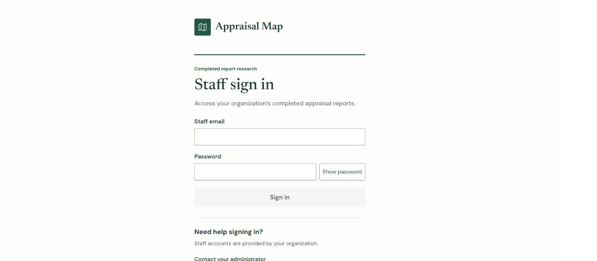
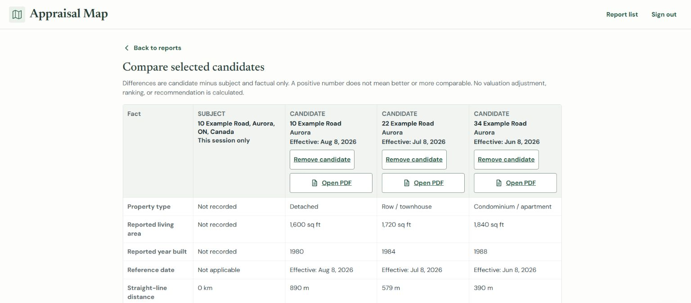

# Lovable UI redesign review

Lovable designed the interface in an isolated [Appraisal Map project](https://lovable.dev/projects/ec009bc9-89c5-4755-955f-769ea1546ae0). This branch adapts its reviewed design to the existing React JavaScript / Create React App application. The integration base is `860494295a02cf6935aaa636f6dbdc0185d573d0`.

The interface uses solid warm-white surfaces, forest green, DM Sans, and Newsreader. Primary actions have visible text labels. Frequent filters stay visible. Forms, details, and comparison use focused layouts. Narrow comparison pairs each candidate's facts with the subject. The sign-in page has no gradients or decorative backdrop.

## Screens

These captures use fictional records and synthetic services. They show the integrated application, not production data.

## Preserved behavior

- GoogleMap / MarkerLayer / Marker code, options, marker and cluster styles, camera handlers, camera controls, map helpers, and the original Map.css are unchanged. New outer wrappers only position or show the canvas.
- Existing Supabase authentication, server roles, domain rules, service-area checks, private document links, Worker/R2 paths, and deployment configuration remain in place. No dependency or build-system change was made.
- Existing address verification, matched-address confirmation, manual placement, duplicates, save intents, uploads, cancellation, retry, uncertain-commit reconciliation, archive, restore, and version protection use their original handlers.
- Forms expose optional facts. Back and Cancel use the existing dirty/busy guard. Report context and focus return after focused views.
- Archive recovery remains visible beside routine notices. Recovery state clears on account or editing-access changes. Late callbacks from an earlier session cannot recreate it.
- Archive recovery message text retains polite status announcements and assertive error announcements. Recovery buttons stay outside the live message.
- Report-list search accepts both stored property-type codes and their readable labels. The list keeps its original search, refresh, paging, and document capabilities.

Presentation styles use repeated `.am-ui` specificity to override the original lazy-loaded styles. The class is not placed on the Google canvas or its ancestors. This keeps the map's inherited theme and controls intact.

## Validation

| Check | Result |
|---|---|
| `npm run lint` | Passed |
| `CI=true npm run test:ci -- --runInBand` | Passed: 22 suites, 172 tests |
| `npm run build` | Passed |
| `npm run verify:build` | Passed |
| `node --test worker/limits.test.mjs` | Passed: 7 tests |
| `python -m unittest discover -s scripts -p test_database_health.py -v` | Passed: 15 tests |
| Worker JavaScript syntax checks | Passed |
| `npm audit --audit-level=critical` | Passed; no critical advisories |
| Original-map structure and protected-file comparison | Passed: 23 checks |
| Downloaded Lovable v2 kit preservation checks | Passed: 161 assertions |
| Browser accessibility scans | Zero detected violations on sign-in, add, details, comparison, and recovery failure |

The unchanged baseline passed all required checks with 169 tests. The three added cases cover account changes, loss of editing access, and archive/recovery announcement semantics. Existing tests were updated for new labels, visible fieldsets, retained hidden views, and recovery metadata. Their save, restore, validation, and permission assertions remain.

Independent browser checks used the actual App and components with synthetic adapters outside the repository. They covered sign-in success/error and password visibility; subject keyboard selection; three-candidate selection; factual differences and missing data; return context; add/edit readback; dirty navigation; manual-location confirmation; upload failure and retry; version conflict; archive/restore and restore failure/retry; PDF rendering; viewer restrictions; offline feedback; and map-failure list access.

Layouts were inspected at 1440×900, 1536×724, 820×1180, 390×844, and 320×844. Comparison has no horizontal page overflow. Source actions sit in desktop candidate headings and before mobile facts. At 768×362, the focused year input stayed visible and the save bar became static. This is a zoom-equivalent layout check, not native browser zoom.

Default input boundaries measure 3.55:1 against white. Focus measures 4.69:1. Inputs, necessary outline actions, errors, and disabled states remain distinct after the original styles load.

## Review scores

These are design-review judgments supported by the observations above. They are not a certification.

| Screen | Craft | Usability | Hierarchy | Consistency | Responsive | Accessibility | Functionality |
|---|---:|---:|---:|---:|---:|---:|---:|
| Sign-in | 9.2 | 9.1 | 9.2 | 9.3 | 9.1 | 9.0 | 9.2 |
| Workspace / search / reports | 9.1 | 9.1 | 9.2 | 9.2 | 9.0 | 8.8 | 9.2 |
| Comparison | 9.1 | 9.3 | 9.3 | 9.2 | 9.2 | 8.8 | 9.2 |
| Details / documents | 9.0 | 9.2 | 9.2 | 9.2 | 9.2 | 8.8 | 9.2 |
| Add / edit / safeguards | 9.0 | 9.1 | 9.1 | 9.2 | 9.1 | 8.8 | 9.3 |
| Recovery / independent list | 9.0 | 9.0 | 9.1 | 9.2 | 9.0 | 8.8 | 9.2 |

Overall review: approximately **9.1/10**. No important category is below 8.

Lovable's final counter-review inspected the integrated diff, complete presentation CSS, verification notes, and four actual screenshots. It accepted the presentation and retained contracts after one minimal correction: restore the archive-recovery message's status/alert semantics. That exact correction is included. The announcement regression check failed before the correction. Native screen-reader announcement timing still requires a real assistive-technology check.

## Verification limits

Live Google Maps resize, touch behavior, production authentication, and private storage were not exercised against production. Their existing implementations remain wired and were checked through source preservation, automated tests, and synthetic browser flows. Native zoom, a full browser matrix, and assistive-technology certification remain separate checks.

The dependency audit reports 63 high, 33 moderate, and three low advisories in the existing CRA dependency tree. An independent audit of the unchanged baseline reports the same counts. Both lockfiles have SHA-256 `ba6df8ae2da2131b9da9fa537c3eb0abf3e2a2e2ed79fe648cdb36c8687e1d22`. The critical-advisory CI gate passes. This branch does not resolve those existing build-tool advisories. npm's proposed forced replacement with `react-scripts@0.0.0` would break the required build setup. Dependency remediation needs a separate compatible toolchain change.

The SQL storage integration script requires a local restored verification database. It was not run here. No production database or storage test was substituted for it.

Recovery holds the most recent archived report in React memory. It does not survive reload or sign-out and does not add an archive-history feature. The independent report list retains its original capability limits. Font loading uses the accepted Google Fonts stylesheet with Arial/Georgia fallbacks.

No production records or infrastructure were changed. No merge, deployment, publication, or pull request was performed.
